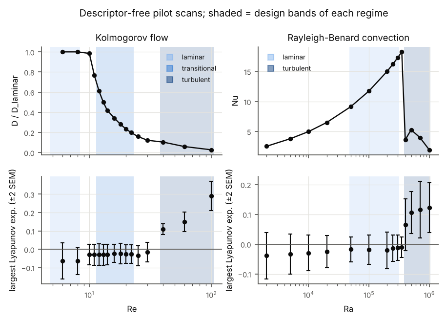
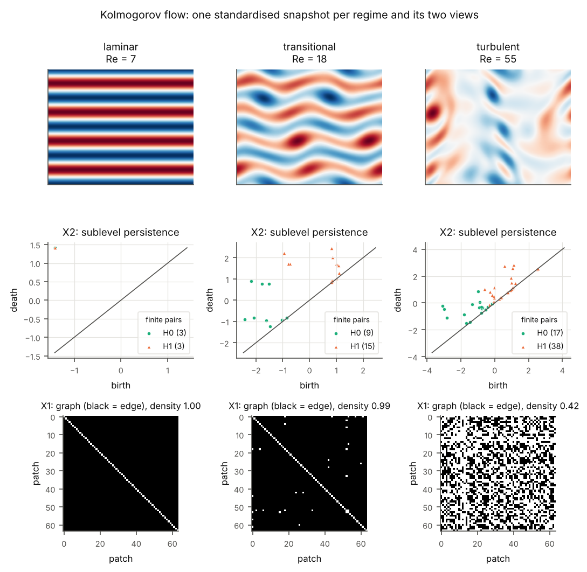
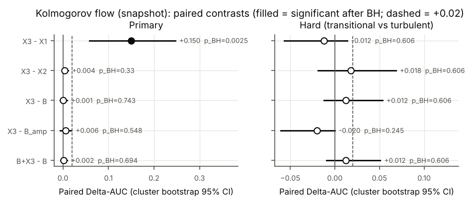
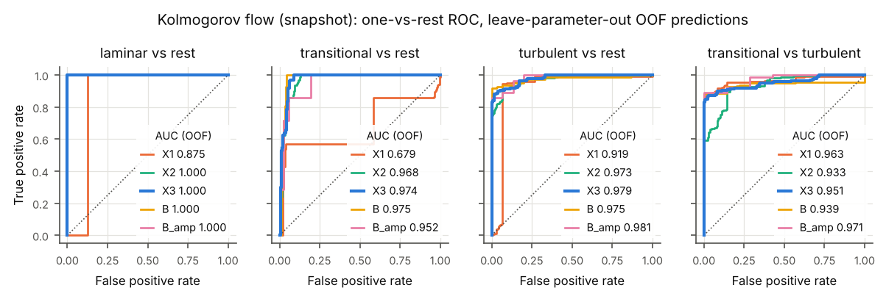
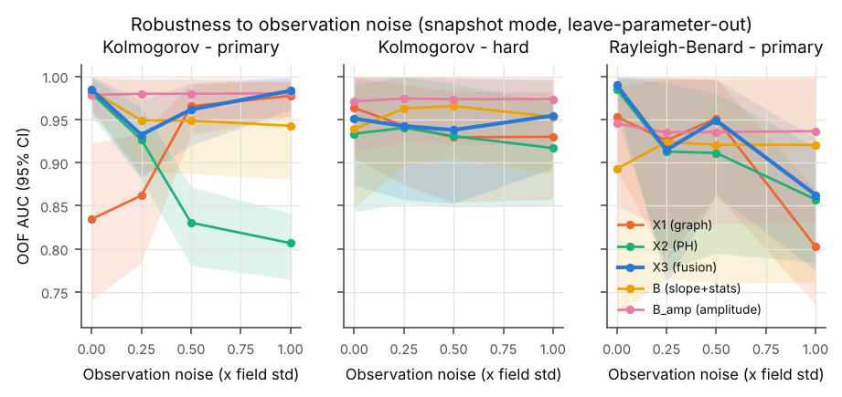
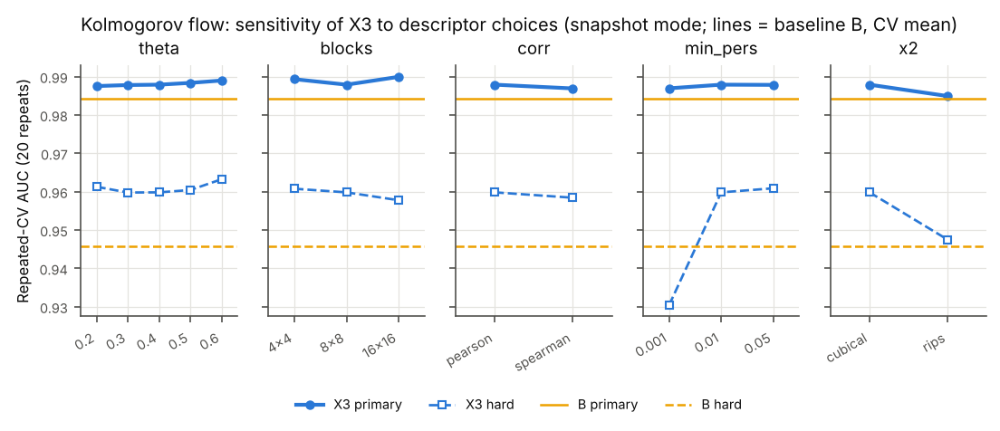
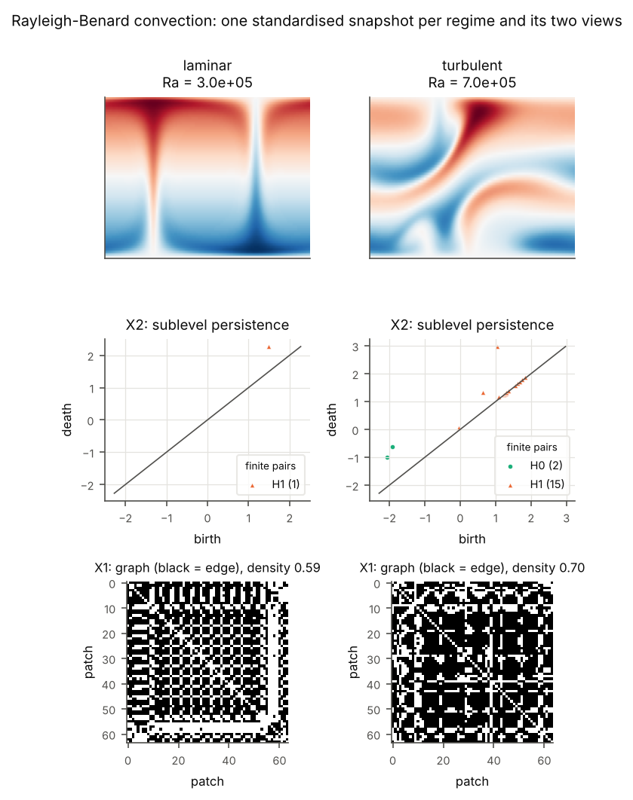
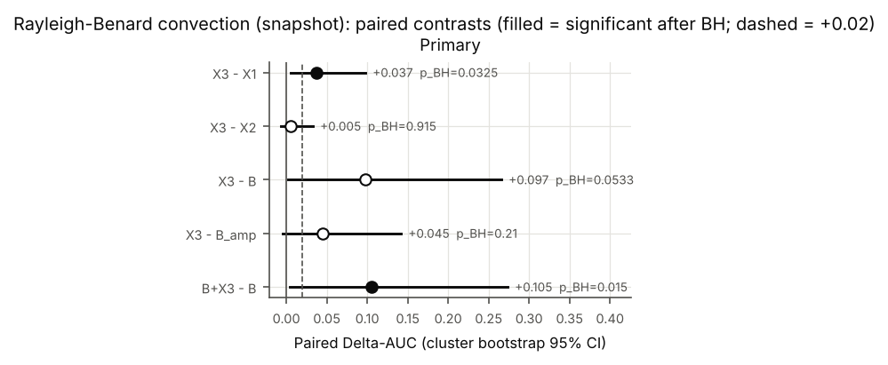

# Go/No-Go checkpoint report — GEM topical collection

*Computational Methods and Techniques Applicable to Geophysical Fluids*
(Springer GEM — International Journal on Geomathematics; submission deadline
15 Dec 2026; internal checkpoint 1 Nov 2026). Report date: 30 Oct 2026.

## Verdict: **PLAN C (NO-GO)**

> Pre-registered rule (`tsg/decision.py` → `results/checkpoint_verdict.json`). On the primary flow (Kolmogorov) X3 does not beat the spectral-slope + simple-statistics baseline by the required margin (**G1 fails**), and the fusion does not beat its single views (**G2 fails**). The Rayleigh–Bénard replication criterion is formally met, but the effect rests on one borderline trajectory (§2.6). The verdict does not depend on the labelling amendment: with the original labels every Kolmogorov endpoint is at ceiling, which the rule also maps to PLAN C.

**In one paragraph.** The multiview descriptor X3, ported from the neural-network
paper, **does** encode the flow regime. It reaches a Regime AUC of 0.985 on
Kolmogorov flow, well above chance (group-level permutation p = 0.005) and
under a leakage-free leave-Reynolds-out protocol. It does **not** beat the
simple spectral-slope + statistics baseline, and it does not beat its own best
single view. On the pre-registered decision endpoint (transitional vs
turbulent, Kolmogorov) ΔAUC(X3 − B) = +0.012, 95 % CI [−0.012, +0.053],
p_BH = 0.61, below the +0.02 "clear" threshold and not significant. The
graph view X1 alone does as well as the fusion: ΔAUC(X3 − X1) = −0.012. A
trivial amplitude proxy (the raw field variance, which tracks Re) does as
well as or better than every structural descriptor. No secondary analysis
changes this: 3 noise levels, space-time windows, a random forest, a
sensitivity sweep, and a Rayleigh–Bénard replication whose apparent X3 advantage hinges on a single borderline label. The project as specified, "X3
separates regimes clearly better than each view and than spectral
baselines", should **not** be submitted. §4 lists the Plan B/C options with a
realistic path to 15 Dec.

Everything here follows the pre-registered protocol in [`PROTOCOL.md`](PROTOCOL.md).
It was frozen in commit `b6718d4` before any descriptor was computed on the
experimental data, and its two amendments (§5) were made before that point too.
Numbers come from `results/*/metrics.json`. Full tables are in
[`results/summary_tables.md`](results/summary_tables.md) and the verdict
computation in [`results/checkpoint_verdict.json`](results/checkpoint_verdict.json).

---

## 1. What was done

### 1.1 Flows and data (`tsg/solvers.py`, `scripts/01_simulate.py`)

| | Kolmogorov flow (primary) | Rayleigh–Bénard convection (replication) |
|---|---|---|
| Model | 2D Navier–Stokes, vorticity form, body force `sin(4y) x̂`, ν = 1/Re | 2D Boussinesq, free-slip isothermal plates, Pr = 1, Γ = 2, free-fall units |
| Numerics | Fourier pseudo-spectral, 128², 2/3 de-aliasing, integrating-factor RK4, CFL 0.5 | Fourier × sine (odd extension), 128 × 64, same scheme |
| Observed field | vorticity ω | temperature anomaly θ |
| Regimes (design) | laminar Re ∈ {5, 6, 7, 8}; transitional (steady coherent states) Re ∈ {12, 15, 18, 22}; turbulent (chaotic) Re ∈ {40, 55, 70, 100} | laminar (steady rolls) Ra ∈ {5·10⁴, 10⁵, 2·10⁵, 3·10⁵}; turbulent (chaotic shear-bursting) Ra ∈ {4·10⁵, 5·10⁵, 7·10⁵, 10⁶} |
| Trajectories | 4 random ICs × 12 Re = 48 | 4 × 8 Ra = 32 |
| Samples | 12 snapshots per trajectory, 20 time units apart, after a 300-unit spin-up | same |

Validation (`tests/`): Taylor–Green decay to 10⁻¹⁰, laminar Kolmogorov fixed
point, energy budget dE/dt = I − D, RB linear growth rate within 1 % of linear
theory, sub-critical RB decay.

**Labels never come from the descriptors.** Each trajectory is labelled from
its own dynamics. Turbulent: twin-trajectory largest Lyapunov exponent
λ̂₁ > 0.01 (Amendment 2; originally λ̂₁ − 2·SEM > 0). Laminar: distance to the
laminar state (Kolmogorov) or CV of Nu (RB) below 10⁻³. Otherwise
transitional. The regime bands come from descriptor-free
pilot scans (`results/pilot/`, `results/fig_regime_scan.png`).

### 1.2 The descriptor, ported (`tsg/descriptors.py`)

Same code path as the network paper (`desc_x1` invariants, `sig6` summary,
`desc_x3` fusion); only the *object* changes.

* **X1 ∈ ℝ¹⁰ (functional graph).** The standardised field is cut into
  8 × 8 = 64 patches (the analogue of the 80-neuron cap). Each patch is a
  node; its pixels in local coordinates are the samples; |Pearson r| > 0.40
  is an edge ("coherence between mesh regions"). Ten invariants: density,
  average clustering, transitivity, degree mean/std/max-fraction,
  components fraction, edges per node, betweenness mean/std.
* **X2 ∈ ℝ¹² (persistent homology).** Sublevel-set filtration of the
  standardised field on a cubical complex (periodic boundaries where the
  domain is periodic, via GUDHI); finite H0 (vortices/cold blobs: minima) and
  H1 (loops around maxima) pairs with persistence ≥ 0.01σ; the original
  `sig6` = (mean, std, max, sum, count, 75th percentile) of the persistences.
* **X3 ∈ ℝ²²** = `[X1/‖X1‖, X2/‖X2‖]`, the paper's label-free fusion.

### 1.3 Baselines (`tsg/baselines.py`)

* **B ∈ ℝ⁷** — log–log slope of the energy spectrum (Kolmogorov: isotropic
  kinetic-energy spectrum E(k) from ω, fit over 5 ≤ k ≤ 30; RB: horizontal
  θ-variance spectrum, 2 ≤ m ≤ 30), spectral centroid, skewness, kurtosis,
  peak/rms, ⟨|∇q|²⟩/⟨q²⟩, gradient anisotropy, on the same standardised field.
* **B_amp ∈ ℝ²** — log₁₀ variance and log₁₀ spectral energy of the *raw*
  field: a trivial proxy of Re/Ra, used only as the confound control
  (analogue of the `n_params`/depth baseline of the network study).

### 1.4 Statistical protocol (`tsg/protocol.py`)

Ported from `phase11_leakfree.py` / `phase14_baselines.py` /
`phase17_experiments.py`, adapted to autocorrelated samples:

* Classifier: `StandardScaler` + one-vs-rest `LogisticRegression(C=1)`
  (unchanged); metric: weighted one-vs-rest ROC AUC ("Regime AUC", the
  analogue of the Family AUC).
* **Leave-parameter-out** `StratifiedGroupKFold` (groups = Re or Ra, k = 4,
  60 repeats): the test fold always holds Reynolds/Rayleigh numbers that the
  classifier never saw. Out-of-fold probabilities averaged over 20 partitions.
* 95 % CIs and paired ΔAUC from a **stratified cluster bootstrap over
  trajectories** (B = 2000) — the trajectory, not the snapshot, is the
  independent unit. Benjamini–Hochberg over the 5 contrasts of each endpoint.
* Group-level permutation test vs chance (200 permutations), Wilcoxon on the
  repeated-CV AUCs (descriptive), Kruskal–Wallis / Mann–Whitney feature tests
  on per-trajectory means (BH), X1 × X2 Spearman redundancy (BH).
* Confound controls: amplitude removed from every view; B_amp; incremental
  (B + X3) vs B; leakage demonstration with a naive snapshot-level CV;
  random-forest classifier; observation-noise data sets.

---

## 2. Results

### 2.1 Regimes obtained (descriptor-free labels)

**Kolmogorov flow (n = 4, 128²).** Laminar up to Re ≈ 10. Non-laminar
**steady or travelling** coherent states for 11 ≤ Re ≤ 25, several coexisting
at the same Re: two distinct states at Re = 18. Time-dependent at Re = 30.
Chaotic (λ₁ > 0) from Re = 40. In the data set, 2 of the 4 initial conditions
at Re = 22 reached a chaotic attractor (λ̂₁ = 0.034 and 0.051) and are labelled
*turbulent* by their dynamics. The original 2-SEM rule would have called them
*transitional*: these are the only 2 of 48 labels that depend on Amendment 2.

**Rayleigh–Bénard (free-slip, Pr = 1, Γ = 2).** Steady rolls up to
Ra = 3.5·10⁵, then an abrupt transition to chaotic shear-bursting convection
(Nu bursts between ≈ 1 and ≈ 14). There is no periodic window, so the
replication is two-regime. With 4 initial conditions per Ra the system is **bistable near the transition**. Steady rolls persisted in 3/4 runs at Ra = 4·10⁵ and 1/4 at 5·10⁵ (laminar by their dynamics), leaving 20 laminar and 12 turbulent trajectories. One run, Ra = 4·10⁵ r1, is borderline: steady to a Nu CV of 4·10⁻⁶, yet λ̂₁ = 0.015 > 0.01, so it is labelled turbulent. Under the original 2-SEM rule, 7 of the 12 chaotic runs (λ̂₁ = 0.03–0.06, block SEM 0.02–0.03) would have been *transitional* and excluded.

### 2.2 Kolmogorov flow — the decision

Leave-Reynolds-out CV, 576 snapshots, 48 trajectories, 13 (Re, label) groups.
"OOF" = pooled out-of-fold AUC with a cluster-bootstrap 95 % CI over
trajectories; "CV" = mean per-fold AUC over 60 repetitions (the statistic of
the network paper).

| View | Primary 3-class, OOF [95 % CI] | CV | **Hard: transitional vs turbulent**, OOF [95 % CI] | CV |
|---|---|---|---|---|
| X1 graph | 0.834 [0.741, 0.923] | 0.898 | **0.963** [0.906, 0.999] | 0.932 |
| X2 PH | 0.980 [0.954, 0.998] | 0.988 | 0.933 [0.843, 0.990] | 0.947 |
| **X3 fusion** | **0.985** [0.960, 1.000] | 0.988 | **0.951** [0.874, 0.999] | 0.960 |
| B slope + stats | 0.984 [0.960, 1.000] | 0.984 | 0.939 [0.848, 1.000] | 0.946 |
| B_amp (Re proxy) | 0.979 [0.949, 0.998] | 0.974 | 0.971 [0.915, 1.000] | 0.940 |
| B + X3 | 0.985 [0.961, 1.000] | 0.987 | 0.951 [0.872, 1.000] | 0.954 |

The primary endpoint is at **ceiling** (B = 0.984 ≥ 0.98), so the
pre-registered rule moves the decision to the **hard** endpoint (B = 0.939).
On it:

| Paired contrast (hard) | ΔAUC | 95 % CI | p | p_BH | criterion |
|---|---|---|---|---|---|
| X3 − B | +0.012 | [−0.012, +0.053] | 0.61 | 0.61 | **G1 fails** (needs ≥ +0.02 and CI > 0) |
| X3 − X1 | −0.012 | [−0.057, +0.014] | 0.53 | 0.61 | **G2 fails** |
| X3 − X2 | +0.018 | [−0.019, +0.068] | 0.42 | 0.61 | **G2 fails** |
| X3 − B_amp | −0.020 | [−0.061, −0.000] | 0.049 | 0.25 | G4 (confound flag) fails |
| (B + X3) − B | +0.012 | [−0.009, +0.051] | 0.45 | 0.61 | no incremental value |

Above chance: every view on both endpoints (group-level permutation, 200
permutations: primary p = 0.005 for X1, X2, X3 and B; hard p = 0.035–0.055,
where only 9 parameter groups exist).

**Where the differences on the hard endpoint come from.** Every method is
essentially perfect on transitional vs turbulent *except* on two kinds of
trajectory. (i) The two weakly chaotic runs at Re = 22: every method gives
them p(turbulent) < 0.5, so **none** detects incipient chaos from a snapshot.
(ii) A secondary travelling-wave state at Re = 18, which X2 alone mistakes for
turbulence (p = 0.97). Without the two Re = 22 runs, the hard AUCs are X1 0.997,
X2 0.968, X3 0.998, B 0.999, B_amp 1.000. The benchmark is trivial away from
the transition, and at the transition no snapshot descriptor works. The
method ranking rests on a handful of trajectories.

### 2.3 Why fusion does not help here

* **The two views are redundant on fluids.** Spearman |ρ| between the 10 × 12
  X1 × X2 feature pairs, on per-trajectory means: median 0.74; 87 % of pairs
  significant after BH; 66 % above 0.6. Both views track a single "structural
  complexity" axis (number and persistence of extrema, loss of patch
  coherence) that the spectral slope and kurtosis also track (Kruskal–Wallis
  ε² ≈ 0.85–0.90 for the top X2 *and* B features). In the network study the
  two views were close to complementary; on these flows they are not, so
  concatenating them adds dimensions and no information.
* **X1 saturates on smooth fields.** At θ = 0.40 the patch-coherence graph is
  complete (density 1.0) for every laminar and transitional snapshot (bottom
  row of the figure above): 16 × 16-pixel patches of a smooth stripe
  pattern are all strongly (anti)correlated. It only varies inside the
  turbulent class. This is why X1 is weak on the 3-class problem (0.83) yet
  good on transitional-vs-turbulent.

### 2.4 Confound and protocol controls

* **Amplitude proxy.** B_amp (log variance of the raw field) is as good as or
  better than every structural descriptor on every endpoint (0.97–0.98). In
  non-dimensional Kolmogorov flow the energy level is almost a monotone
  function of Re, so regime classification across Re is close to trivial when
  the amplitude is available. The descriptors were deliberately made
  amplitude-free. Their value would have to come from settings where the
  amplitude is uninformative, which this benchmark does not contain.
* **Leakage.** A naive snapshot-level CV (ignoring trajectories/Re) inflates
  every AUC: X3 0.997 vs 0.988 grouped, B 0.996 vs 0.984. The grouped design
  matters.
* **Pseudo-replication.** The Wilcoxon test on the 60 repeated-CV AUCs gives
  p ≈ 10⁻¹¹ for "X3 > B" on the hard endpoint, because the repeats re-use the
  same 32 trajectories. The trajectory-level bootstrap (p = 0.61) is the honest
  test. A reviewer of the network paper could raise the same point about its
  Fig. 4 (5-fold Wilcoxon).
* **Classifier.** A random forest gives the same picture (hard endpoint: X1 0.84,
  X2 0.93, X3 0.94, B 0.94, B_amp 0.98).

### 2.5 Robustness (secondary, never changes the verdict)

**Observation noise** (Gaussian, σ in units of the field std):

| Kolmogorov, primary OOF AUC | clean | σ = 0.25 | σ = 0.5 | σ = 1.0 |
|---|---|---|---|---|
| X1 graph | 0.834 | 0.862 | 0.965 | 0.977 |
| X2 PH | 0.980 | 0.927 | 0.830 | 0.807 |
| X3 fusion | 0.985 | 0.932 | 0.962 | 0.983 |
| B slope + stats | 0.984 | 0.949 | 0.949 | 0.943 |
| B_amp | 0.979 | 0.980 | 0.980 | 0.980 |

Contrary to the usual stability argument for persistent homology, the
`sig6` summaries of X2 are **fragile** under white noise. Noise adds many
short-lived pairs that swamp the count and spread statistics. From clean to
σ = 1.0, Kruskal–Wallis ε² across regimes drops from 0.89 to 0.07 (H0 count),
0.90 to 0 (H1 count) and 0.87 to 0.36 (H0 std). Only the maximum persistence,
the quantity the stability theorem actually protects, holds up (0.64 → 0.76). X1 becomes *more* informative with noise:
noise breaks the saturated complete graphs, and the surviving edges reflect
local signal-to-noise. The largest X3 − B gap appears at σ = 1.0 (+0.041,
95 % CI [−0.005, +0.099], p_BH = 0.22), and it is not significant. On the
hard endpoint B > X3 at σ = 0.25 and 0.5 (0.963 vs 0.942, 0.966 vs 0.938) and
they tie at σ = 1.0 (0.953 vs 0.954).

**Space-time windows** (16 frames, X1 = climate network): the baseline,
which then includes temporal statistics, is at ceiling (0.993). On the hard
endpoint B 0.957 > X3 0.931.

**Sensitivity sweep** (`results/kolmogorov_snapshot/sensitivity.json`): X3 stays within 0.985–0.990 (primary) and 0.930–0.963 (hard) across
θ ∈ {0.2, …, 0.6}, 4×4 / 8×8 / 16×16 patches, Pearson vs Spearman, a
persistence floor of 0.001 / 0.01 / 0.05σ, and the Vietoris–Rips X2 of the
original paper. Even the best variant picked after the fact (θ = 0.6, hard
0.963) is only +0.017 above the baseline's CV mean (0.946). That is below the
+0.02 threshold before any correction for having picked it. The persistence
floor is the only choice that matters: 0.001σ admits round-off pairs and drops
the hard AUC to 0.930. X1 itself de-saturates at θ = 0.6 or with 4×4 / 16×16
patches (primary 0.975–0.991), which confirms the saturation diagnosis. X3 does
not improve, because X2 already carries the same information.

### 2.6 Rayleigh–Bénard replication

Binary laminar vs turbulent, leave-Rayleigh-out (8 Ra values, k = 4),
384 snapshots, 32 trajectories. The baseline is not at ceiling, so clean-primary
is the RB decision endpoint.

| View | OOF AUC [95 % CI] | CV mean | permutation p |
|---|---|---|---|
| X1 graph | 0.953 [0.892, 0.988] | 0.931 | 0.025 |
| X2 PH | 0.985 [0.954, 1.000] | 0.962 | 0.045 |
| **X3 fusion** | **0.990** [0.971, 1.000] | 0.994 | 0.005 |
| B slope + stats | 0.893 [0.722, 0.996] | 0.725 | 0.26 |
| B_amp | 0.945 [0.849, 0.998] | 0.790 | — |
| B + X3 | 0.998 [0.990, 1.000] | 1.000 | — |

| Paired contrast | ΔAUC | 95 % CI | p_BH |
|---|---|---|---|
| X3 − B | +0.097 | [+0.002, +0.266] | 0.053 |
| X3 − X1 | +0.037 | [+0.005, +0.098] | 0.033 |
| X3 − X2 | +0.005 | [−0.007, +0.033] | 0.92 |
| X3 − B_amp | +0.045 | [−0.004, +0.142] | 0.21 |
| (B + X3) − B | +0.105 | [+0.004, +0.273] | 0.015 |

On face value this is the result the project hoped for: topology beats the
spectral baseline, and the replication criterion R (X3 > B and X3 ≥ best
view − 0.01) holds. The views are also far less redundant than in Kolmogorov
flow (median |ρ| = 0.33, 37 % of pairs significant), and the top Kruskal–Wallis
effects are all X2 features (ε² ≈ 0.8). **The diagnosis does not support
reading much into it:**

* **One trajectory drives the gap.** Without the borderline near-steady
  run at Ra = 4·10⁵ (r1), B rises from 0.893 to 0.973 while X3 stays at 0.990
  and X2 at 0.992. B assigns that run p(turbulent) = 0.02, the same as its
  steady neighbours, which is physically the right call. X3 assigns it 0.70.
  The most likely cause is that X1's patch grid is not translation invariant:
  the four steady 4·10⁵ runs are the same roll pattern at different
  horizontal phases, and X3 gives them 0.14–0.70.
* **Label sensitivity.** Labelling that run *laminar* (steady-first rule):
  X3 0.984, B 0.960, ΔAUC +0.024 [−0.004, +0.057], n.s., and B_amp 0.981.
  With the original 2-SEM labels: X3 0.988, B 0.972, Δ +0.016, n.s., and
  B_amp 0.996.
* **Instability.** The RB sensitivity sweep moves X3 between 0.865 and 0.999
  (θ, patch size, persistence floor, Rips).
* **Noise.** With observation noise the advantage disappears: σ = 0.25:
  X3 0.915 vs B 0.924; σ = 0.5: 0.949 vs 0.921; σ = 1.0: 0.863 vs 0.920.

There is one genuinely interesting hint. Along the laminar branch, X2 is
nearly Ra-invariant (the same roll topology at every Ra), while the spectral
statistics drift with Ra (thinner boundary layers). Under leave-Ra-out CV that
favours topology when generalising to unseen Ra. It is worth testing on fresh
data (§4), but it cannot carry the checkpoint.

*Verdict robustness to the labelling rule.* With the original (frozen) labels,
every Kolmogorov endpoint is at ceiling, both clean (B 0.999 / 1.000) and
noisy (σ = 0.5: B 0.991 / 0.995). The rule's outcome is then "no
discrimination possible", also **PLAN C**.

---

## 3. What failed, specifically

1. **The baseline is strong because the regimes differ in smoothness.** In
   these 2D flows at moderate Re/Ra, laminar → coherent → chaotic is mostly a
   monotone change in spatial smoothness and intermittency. In the
   5 ≤ k ≤ 30 band, E(k) falls off as k⁻¹²…k⁻¹⁵ for the coherent states,
   k⁻¹² at Re = 40 and k⁻⁷·⁵ at Re = 100. The spectral slope and the kurtosis
   capture this axis as well as topology does.
2. **The amplitude is a near-perfect proxy of the control parameter.** Any
   regime benchmark built by sweeping Re or Ra in one non-dimensional system
   lets the energy level do the work. The amplitude-free descriptors are
   competitive with it, but not better.
3. **The fusion premise does not transfer.** The X1/X2 complementarity that
   motivated the fusion for neural activations is absent here (median
   |ρ| = 0.74), so X3 = [X1/‖X1‖, X2/‖X2‖] cannot beat its best view.
4. **The informative part of the benchmark is a few trajectories at the
   transition.** Away from it every method, the amplitude proxy included, is
   at AUC ≥ 0.97. At it (weakly chaotic Kolmogorov runs at Re = 22, near-steady RB
   runs at Ra = 4·10⁵) no snapshot descriptor is reliable, and labels
   themselves become delicate (two protocol amendments).
5. **The decisive comparisons are under-powered.** The hard endpoint rests on
   14 transitional trajectories with only ~5 distinct coherent states, so
   bootstrap CIs are ±0.05 wide. A true advantage of +0.02 could not have been
   detected. The point estimate is below +0.02 anyway, so more data would
   not rescue the "clearly better" claim.

## 4. Plan B / Plan C

The pre-registered rule gives **PLAN C (NO-GO)**: do not submit the claim "X3
separates flow regimes better than its views and than spectral baselines".
The checkpoint does support three facts a follow-up can build on:

1. the descriptor is a valid regime signature (AUC 0.95–0.99, above chance);
2. the views behave very differently under noise (X1 robust, X2 fragile);
3. on RB there is a hint that topology generalises better than spectral
   statistics to unseen control parameters along a dynamical branch.

None of these is established by this data set.

**C1 — sparse, irregular observations (recommended).** Real geophysical
observations are often stations, drifters or floats. E(k) cannot be computed
on such data, and amplitudes are not comparable across instruments, but a
coherence graph on the stations (X1) and the PH of the point cloud or
interpolated field (X2) can be. This is the setting where a structural
descriptor has a real reason to exist. The study: sub-sample *new* simulations
(fresh seeds; the generator is ready) at 64–256 random stations, with a
station-level baseline (variogram slope + moments) in place of B, and the
same leak-free protocol and decision rule. Pre-register it before running.

**C2 — generalisation across parameters / systems.** Test the RB hint
properly: train on one Ra range and test on a disjoint one, and train on
Kolmogorov and test on RB (laminar vs chaotic), where the amplitude proxy
cannot transfer by construction. Cheap, but RB showed how fragile this is.

**C3 — methods / negative-result note (fallback, deliverable in any case).**
Topics: the pre-registered pipeline, the amplitude confound, the
pseudo-replication of repeated-CV Wilcoxon tests (p ≈ 10⁻¹¹ vs the bootstrap's
0.61), the noise fragility of `sig6` PH summaries, view redundancy, and the
"trivial away from the transition, impossible at it" structure of regime
benchmarks. It fits GEM less well than C1, but it is honest and on time.

**Plan B design fixes, to be pre-registered for any follow-up (never tuned on
this data set):**

* **B1** — X1 at fixed **edge density** (climate-network practice) instead of
  fixed θ, and a translation-invariant patch similarity (max cross-correlation
  over shifts). Removes the saturation and the phase artefact seen in RB.
* **B2** — stable PH vectorisations (persistence images/landscapes, or a
  persistence floor tied to the noise level) instead of `sig6` counts and means.
* **Benchmark design** — sample densely near the transitions, with many
  independent ICs per parameter: that is where methods differ. Fix the
  labelling rule on the pilot *including* intermittent states. Both amendments
  here came from not doing this.

**Suggested timeline to 15 Dec.**

* 1 Nov: checkpoint decision (this report).
* 2–8 Nov: pre-register C1 with B1/B2.
* 9–22 Nov: simulations on fresh seeds and analysis; this pipeline runs in
  about 6 h on 4 cores.
* 23 Nov: second checkpoint with the same rule.
* 24 Nov – 12 Dec: write-up, either a C1 paper if it passes or the C3 note
  otherwise.
* 15 Dec: submit.

## 5. Deviations from the protocol

All were made and committed **before any descriptor, baseline or classifier
output existed** (see `git log`):

1. *Design (pre-freeze, §12 of the protocol):* the primary sample was moved
   from 16-frame windows to single snapshots, because the Kolmogorov pilot
   showed that every transitional state is steady (any temporal statistic
   would be trivially decisive). Window mode is kept as secondary.
2. *Integrator fix (`40834b6`):* `advance()` now re-evaluates the CFL step
   every 20 steps. Before the fix the RB start-from-rest blew up. Both data
   sets were regenerated with the fixed code.
3. *Amendment 1 (`eceb9c5`):* RB Lyapunov window 100 → 300 time units.
4. *Amendment 2 (`db5e9fc`):* chaos criterion λ̂₁ − 2·SEM > 0 → λ̂₁ > 0.01.
   Block SEM is not valid for intermittent chaos (bursts). The frozen-rule
   labels are kept in the feature files: they change 2 of 48 Kolmogorov
   labels and 8 of 32 RB labels: 7 chaotic runs would become *transitional* and be excluded, and the near-steady Ra = 4·10⁵ r1 would become *laminar*. §2.6 reports RB under both alternative labellings, and the verdict is PLAN C under either labelling (§2.6, last paragraph).

5. *Analysis bug fix after the first results:* Kruskal–Wallis / Mann–Whitney
   returned NaN on constant features, which made every BH-adjusted feature-test
   q-value NaN. Constant features are now treated as p = 1. Only the feature
   tests changed; every other number was bit-identical on the rerun.

Post-hoc analyses, clearly exploratory: the per-trajectory diagnostics in
§2.2 and §2.6, the label-sensitivity runs (`results/*_label_*`) and the
Kolmogorov noisy run under the original labels.

Not done although planned: none.

## 6. Reproducibility

Code, configuration and every statistic are in this folder; the README has
the full command list. Raw snapshots (~0.8 GB) are not committed. They are
regenerated by `scripts/01_simulate.py` from the same seeds (base seed 2024).
Chaotic trajectories are reproduced exactly only on the same numerical stack
(FFT library, CPU), because round-off differences grow at rate λ₁. The
per-sample feature tables `data/features_*.csv` are committed and
`scripts/03_classify.py` rebuilds every number and figure from them. Compute
used for this report: 4 CPU cores, ~5 h of simulation (80 trajectories), ~1.5 h
of analysis.
Package versions: numpy 2.5.3, scipy 1.18.1, scikit-learn 1.9.1, statsmodels
0.15.0, networkx 3.7, gudhi 3.13.0, ripser 0.6.15, pandas 3.0.5,
matplotlib 3.11.2 (Python 3.13).

## 7. Addendum (30 Oct, later): feasibility of the Plan C pivots

*Exploratory.* These checks reuse the data already analysed above, so they
are not evidence for anything. They only decide whether a pre-registered
follow-up on fresh seeds is worth the compute. Quick settings: 10 CV
repeats, 300 bootstrap resamples.

**C1, sparse stations (`tsg/stations.py`, `scripts/07_stations.py`).** First,
a design limitation I had not flagged in §4: at the snapshot level, X1 has no
faithful station analogue, because a functional graph needs several samples
per node. With station *time series* it does (a climate network), but then
the steady laminar/transitional states make any temporal statistic decisive,
which is the shortcut that pushed the main study to snapshots. So only the PH
view can be tested. It uses the lower-star filtration on the Delaunay complex
of M random stations, against a semivariogram + moments baseline (BS).

| OOF AUC | X2s (station PH) | BS (variogram + moments) | BSamp | X2s − BS [95 % CI] |
|---|---|---|---|---|
| Kolmogorov, M = 64, 3-class | 0.819 | **0.963** | 0.922 | −0.145 [−0.216, −0.090] |
| Kolmogorov, M = 128, 3-class | 0.729 | **0.934** | 0.889 | −0.205 [−0.296, −0.095] |
| Kolmogorov, M = 256, 3-class | 0.903 | 0.916 | 0.916 | −0.013 [−0.133, +0.103] |
| Kolmogorov, M = 128, transitional vs turbulent | 0.445 | **0.902** | 0.817 | −0.458 [−0.616, −0.291] |
| RB, M = 64 | 0.849 | 0.899 | 0.918 | −0.049 [−0.108, −0.000] |
| RB, M = 128 | 0.900 | 0.879 | 0.926 | +0.021 [−0.010, +0.055] |
| RB, M = 256 | **0.985** | 0.920 | 0.939 | +0.065 [+0.013, +0.152] |

On the primary flow, station PH is clearly *worse* than the variogram
baseline: at chance on the transitional-vs-turbulent endpoint for M ≤ 128.
Only RB at M = 256 favours PH, and RB has already shown how fragile its
labels are (§2.6).

**C2, cross-flow transfer (`scripts/08_transfer.py`, `results/transfer.json`).**
Train on one flow, test on the other, chaotic vs non-chaotic.

| AUC | X1 | X2 | X3 | B | B_amp |
|---|---|---|---|---|---|
| Kolmogorov → RB | 0.529 | 0.106 | 0.392 | 0.289 | 0.088 |
| RB → Kolmogorov | 0.968 | 0.798 | 0.660 | **0.986** | 0.007 |

Nothing transfers from Kolmogorov to RB, and from RB to Kolmogorov the
spectral baseline transfers best.

**Updated recommendation.** Neither pivot gives the descriptor a credible
advantage, so I no longer recommend spending the November slot on C1.

* The realistic GEM deliverable is **C3**: a methods / negative-result note.
  Its content: the pre-registered pipeline, the amplitude confound, the
  pseudo-replication pitfall, the noise fragility of `sig6`, view redundancy,
  the "trivial away from the transition, impossible at it" structure, and
  these negative pivots.
* The alternative is to not submit to this collection and keep the
  infrastructure for a different question. One example is extreme-event
  precursors in Kolmogorov flow (Farazmand & Sapsis 2017), where the solver
  and protocol here can be reused directly.
